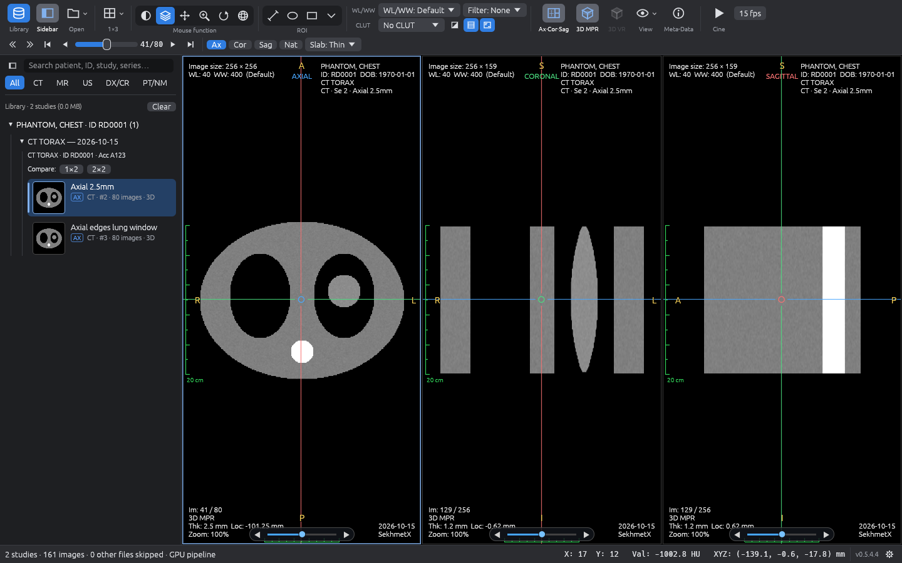
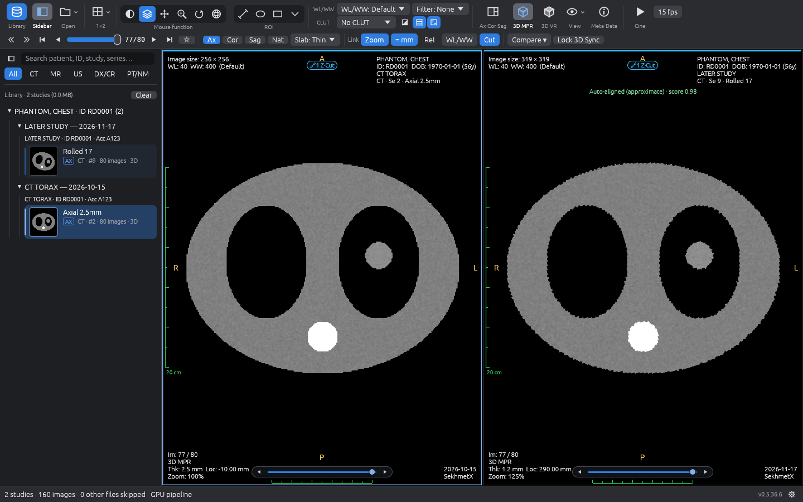
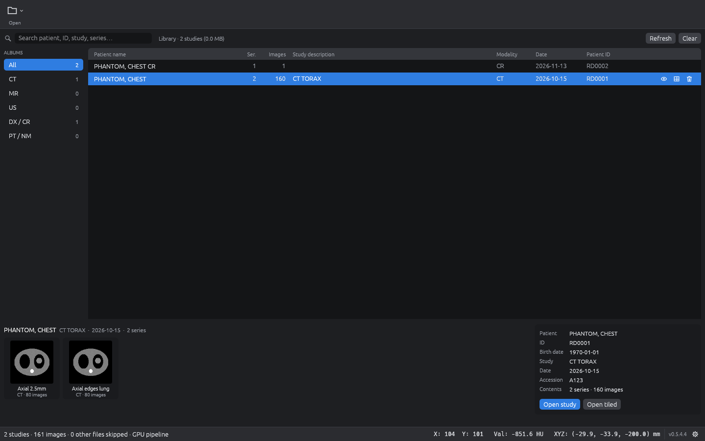

# SekhmetX

**A fast, native DICOM viewer for Windows, macOS and Linux — a Rust port of [IsiX DICOM Viewer](https://github.com/ThalesMMS/IsiX-DICOM-Viewer-macOS).**

[](https://github.com/CosmicTaco22/SekhmetX/releases/latest)
[](https://github.com/CosmicTaco22/SekhmetX/actions/workflows/ci.yml)
[](LICENSE)




SekhmetX brings the IsiX / Horos way of reading studies to every desktop.
[IsiX](https://github.com/ThalesMMS/IsiX-DICOM-Viewer-macOS), by
**Thales Matheus M Santos ([@ThalesMMS](https://github.com/ThalesMMS))**, is an
independently maintained fork of [Horos](https://github.com/horosproject/horos),
which is itself derived from OsiriX. All three are macOS-only. SekhmetX rebuilds
IsiX piece by piece in Rust so the same layout, shortcuts and behaviour run
natively on Windows, macOS and Linux from a single executable.

It is written by a radiologist who reads on both a Mac and a Windows PC, for
people who want a light, responsive viewer that feels like the one they already
know.

> **Not a medical device.** SekhmetX is for personal use, teaching, research and
> second opinions. It is not certified for primary diagnosis.

---

## How the port works

IsiX is about 380,000 lines of Swift and Objective-C built on AppKit, Metal and
Core Data, so it cannot simply be recompiled for other systems. SekhmetX takes a
different route:

- **Logic is ported, file by file.** Window/level rules, VOI LUTs, geometry,
  ROI statistics, colour tables and convolution filters are translated from the
  IsiX sources, keeping their rounding and edge cases. Ported files name the
  IsiX file they follow.
- **IsiX's tests come along.** The expected results in IsiX's test suites are
  translated into Rust tests next to the ported code, so the port is checked
  against the original's own answers.
- **Screens are rebuilt.** The interface is rebuilt with
  [egui](https://github.com/emilk/egui) and the GPU drawing with
  [wgpu](https://wgpu.rs) (Direct3D 12, Metal or Vulkan), laid out to match
  Horos and IsiX.
- **Every IsiX file has a place.** [`PORTING_MAP.md`](PORTING_MAP.md) assigns
  all IsiX files to an area with a decision, a priority and its progress, and
  [`tools/upstream.py`](tools/upstream.py) reports what changed upstream since
  the last review so new IsiX work can be followed.

SekhmetX is not made, sponsored or endorsed by IsiX, the Horos Project, Purview
or Pixmeo. It does not use their names or icons in the application.

---

## Features

**Library**
- Opens folders, single DICOM files and `.zip` / ZIP64 archives (streamed, with
  path and size checks).
- Local SQLite library that opens instantly on later launches; studies grouped
  by patient, with manual linking of the same patient under different name
  spellings.
- Full-window library view with modality albums, a sortable study table, series
  thumbnails and a study details pane; search by patient, ID, accession, study
  or series.
- Axial, coronal and sagittal reconstructions of one acquisition are grouped
  together, and MIP series are kept apart from their source stacks.

**2D viewing**
- GPU window/level with optional bilinear smoothing and a CPU fallback.
- Horos window presets (keys `1`–`9`), 31 Horos colour tables and 22 Horos
  convolution filters.
- Corner annotations, orientation letters, rulers and reference lines.
- Layouts from 1×1 to 4×4, drag-and-drop of series onto any viewport, and
  colour-coded link groups for zoom, window/level and slice position;
  double-click a viewport to enlarge it and again to go back.
- Right-click menu with a palette of every mouse and measurement tool.
- Patient age shown beside the date of birth.

**MPR and 3D**
- In-place 3D MPR and a three-pane Ax·Cor·Sag view with linked crosshairs.
- Native planes return the original pixels unchanged; when the scanner already
  produced coronal or sagittal series, those are shown instead of a
  reconstruction.
- Thick-slab MIP, MinIP and mean; oblique planes with a 3D rotate tool;
  gantry-tilt support and slice-spacing checks.
- GPU volume rendering and 3D MIP with presets, shading, a transfer-function
  editor, clipping and an orientation cube.
- Side-by-side comparison of studies from different dates with automatic 3D
  alignment that matches the body outline (so a patient lying rolled, or a
  scan covering a different stretch of the body, still lines up) and turns the
  other images to match the viewport the comparison started from; or manual
  alignment when the patient lay differently: hold
  `Ctrl`/`Cmd` to move or turn one image alone and it stays linked with that
  difference. Switching a link on makes the others match the viewport you are
  in; "= mm" zoom shows both at the same physical scale.

**Measurements and key images**
- Length, angle, Cobb angle, arrow with text, oval, rectangle, polygon, pencil
  and point, with area, mean, SD, minimum and maximum from the unfiltered
  pixels (also on reconstructed planes); saved per slice.
- Measurements can be moved, reshaped by their handles, and deleted; callouts
  can be dragged aside. Live ratio between two lengths.
- ROI histogram and line profile.
- Calibration of an image without pixel spacing from a length of known size.
- Key images: mark with `K`, filter a series to its key images, and export them
  with an anonymized case summary.

**Export and privacy**
- PNG export of an image or a whole series, and anonymized DICOM export (private
  tags removed, identifiers scrubbed, UIDs remapped consistently).
- `Ctrl+C` / `Cmd+C` copies the active viewport to the clipboard without
  patient details.
- A DICOM metadata inspector beside the image.

**Library housekeeping**
- Clearing the library only empties SekhmetX's own list and never touches your
  folders; removing a study can also move its image files to the Recycle Bin /
  Trash, after asking.

**Application**
- English and Spanish interface; dark, OLED (pure black), light or system
  theme; accent colour of your choice.
- In-app updater that checks GitHub Releases and verifies the download's
  SHA-256 before installing.
- Opt-in crash reports that you review before anything is sent.

---

## Download and requirements

Download the latest build from
[**Releases**](https://github.com/CosmicTaco22/SekhmetX/releases/latest):

| System | File |
|---|---|
| Windows, x86-64 | `sekhmetx-vX.Y.Z-windows-x86_64.zip` |
| Windows on ARM | `sekhmetx-vX.Y.Z-windows-arm64.zip` |
| macOS, Apple Silicon | `sekhmetx-vX.Y.Z-macos-arm64-app.zip` (app) or `.tar.gz` |
| Linux, x86-64 | `sekhmetx-vX.Y.Z-linux-x86_64.tar.gz` |

Each release has a `SHA256SUMS` file. Builds are not yet code-signed, so
Windows SmartScreen and macOS Gatekeeper may ask for confirmation the first
time. A graphics card with Direct3D 12, Metal or Vulkan is used when present.

### Coming from Horos or IsiX

SekhmetX keeps its own library and does not open the Horos or IsiX database.
Open your study folders, files or `.zip` exports with **Open**, or drop them on
the window; they are added to the library and open instantly afterwards.

---

## Mouse and keyboard

| Action | Control |
|---|---|
| Previous / next image | Mouse wheel, `↑` `↓` `←` `→`, or the slice slider |
| Jump 10 images / first / last | `Page Up` / `Page Down`, `Home` / `End` |
| Previous / next series | `[` / `]` |
| Axial / coronal / sagittal | `A` / `C` / `S` (uses the scanner's own series when available) |
| Window / level, zoom | `W`, `Z`; right drag zooms, middle drag pans |
| 3D rotate (oblique MPR) | `O`, then drag; `Shift` + drag to roll |
| Change one linked viewport only (scroll, zoom, pan, window, rotate) | Hold `Ctrl` (`Cmd` on Mac) while doing it; with **Cut** linked, the new offset stays linked when you let go |
| Make the other viewports match this one | Switch a link (**Cut**, **WL/WW**, **Zoom**) on while working in this viewport |
| Window presets | `1`–`9`, `0` for the default |
| Invert | `I` |
| Measurements | `L`/`M` length · `E` oval · `B` rectangle · `G` polygon (`Enter` closes) · `F` pencil · `T` point · `Y` arrow; angle and Cobb angle from the ROI menu or right-click palette |
| Delete selected (or last) measurement | `Delete` / `Backspace` |
| Mark / unmark key image | `K` |
| Cine | `P` or `Space` |
| Flip | `H` / `V` |
| Reset view | `R`, or double-click in a single viewport |
| Enlarge a viewport / back to the layout | Double-click it (with more than one viewport) |
| Copy image without patient details | `Ctrl+C` / `Cmd+C` |

---

## Build from source

You need stable [Rust](https://rustup.rs), a C/C++ compiler and CMake (for
OpenJPEG and CharLS). On Windows, install the Visual Studio C++ Build Tools.
On Linux, install the GTK 3, xkbcommon, Wayland, Vulkan/GL and D-Bus
development packages (see [`.github/workflows/ci.yml`](.github/workflows/ci.yml)
for the exact list).

```bash
git clone https://github.com/CosmicTaco22/SekhmetX.git
cd SekhmetX
cargo test --release
cargo build --release
```

The program is `target/release/sekhmetx` (`sekhmetx.exe` on Windows).
`cargo build --release --no-default-features` drops JPEG-LS support and the
CMake requirement.

### Command-line helpers

```bash
sekhmetx FOLDER_OR_ZIP                       # open the viewer
sekhmetx --list FOLDER_OR_ZIP                # list studies and series
sekhmetx --check FOLDER_OR_ZIP               # decode every image, report failures
sekhmetx --render FOLDER OUT.png [SERIES] [IMAGE] [WIDTH LEVEL]
sekhmetx --roi FOLDER_OR_FILE [SERIES IMAGE] (ellipse|rect|length) X1 Y1 X2 Y2
```

`--roi` prints the same statistics as the viewer, for comparing measurements
against Horos or IsiX.

---

## More screenshots

| Comparing two series side by side | Library |
|---|---|
|  |  |

Screenshots use a synthetic test phantom, not patient data.

---

## Project documents

| File | What it is |
|---|---|
| [`PORTING_MAP.md`](PORTING_MAP.md) | Every IsiX file, its area, decision and progress |
| [`DEVIATIONS.md`](DEVIATIONS.md) | Where SekhmetX knowingly differs from IsiX, and why |
| [`CHANGELOG.md`](CHANGELOG.md) | Release history |
| [`BUGS.md`](BUGS.md) | Known issues |
| [`HANDOFF.md`](HANDOFF.md) | Project history and decisions, for contributors |

---

## License and credits

SekhmetX is free software under the **GNU Lesser General Public License,
version 3 or later** ([`LICENSE`](LICENSE), which supplements the GNU GPL v3 in
[`COPYING`](COPYING)). Parts of it are derived from IsiX, which is distributed
under the LGPL v3, and through it from Horos and OsiriX. SekhmetX is
distributed **without any warranty**; see the licence for details.

Credit for the work SekhmetX ports belongs to:

- **Thales Matheus M Santos ([@ThalesMMS](https://github.com/ThalesMMS))**,
  author and maintainer of [IsiX DICOM Viewer](https://github.com/ThalesMMS/IsiX-DICOM-Viewer-macOS);
- the **Horos Project** and **Nimble Co LLC d/b/a Purview** ([Horos](https://github.com/horosproject/horos));
- the **OsiriX team** (OsiriX, from which Horos derives);
- **Yves Starreveld**, whose Horos work IsiX incorporates;
- and everyone else credited in the IsiX and Horos repositories.

SekhmetX also builds on open-source libraries, each under its own licence:
[dicom-rs](https://github.com/Enet4/dicom-rs) (MIT / Apache-2.0),
[egui / eframe](https://github.com/emilk/egui) and [wgpu](https://github.com/gfx-rs/wgpu)
(MIT / Apache-2.0), [OpenJPEG](https://www.openjpeg.org) (BSD-2-Clause),
[CharLS](https://github.com/team-charls/charls) (BSD-3-Clause) and
[SQLite](https://sqlite.org) (public domain), among others listed in
[`Cargo.lock`](Cargo.lock). See [`NOTICE`](NOTICE) for the full attribution.

OsiriX, Horos and IsiX are names of their respective owners and are used here
only to describe where SekhmetX's design and code come from.
